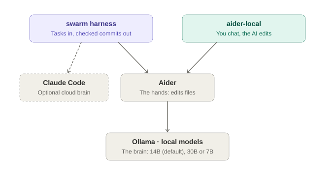
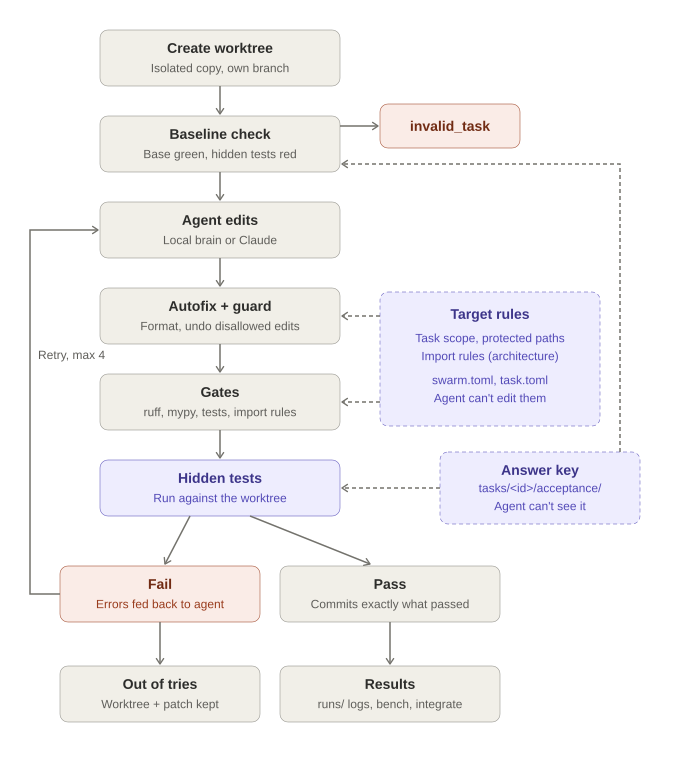
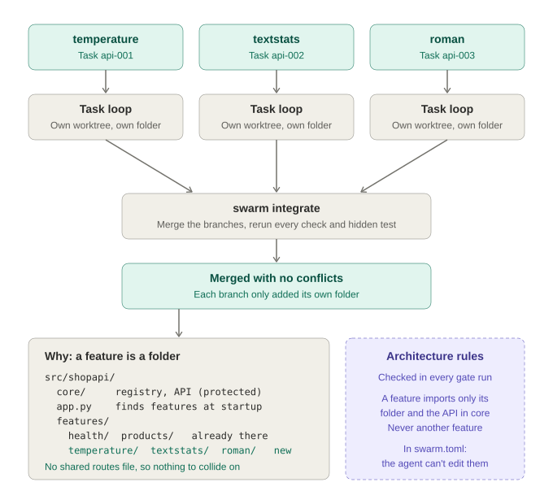

# Agent Swarm v0

A closed-loop harness for coding agents. Each task runs in its own git worktree. An agent
(local model via Aider, or Claude Code) edits code, and the **harness** decides whether the
work is done: tamper checks, then the repo's gates, then hidden acceptance tests the agent
can't see. It commits only when everything passes.

This is the corrected v0 of [`autonomous_coding_agent_swarm_blueprint.md`](autonomous_coding_agent_swarm_blueprint.md).
Continuing on another PC? Start with [`HANDOVER.md`](HANDOVER.md). How the repo was built, step
by step, and how to keep developing it: [`DEVELOPMENT.md`](DEVELOPMENT.md).

## Workflow

Two ways in, one set of hands (Aider) and one brain (a local model in Ollama):



What the harness does for each task. The harness, not the AI, decides when the work is done:



Many tasks at once. Each changes only its own feature folder, so the branches merge without
conflicts (see "Parallel-friendly targets" below):



## What changed from the blueprint

| Blueprint problem | v0 |
|---|---|
| Passing the gate only proves the existing tests pass; a no-op passes a feature task | Each task ships **hidden acceptance tests** kept outside the worktree. A **baseline check** refuses tasks whose hidden tests already pass on base. |
| AGENTS.md rules were only requests | A **guard** reverts edits to protected paths (tests, tool config, rules file) and blocks added `# type: ignore`, `# noqa`, skip/xfail, `collect_ignore`. |
| Retries dropped the original task | Every attempt's prompt = full task + rules + the previous failures. |
| Stopped at the first failing check | All gates run every attempt; the agent sees every failure at once (clipped to a budget). |
| No timeouts | Hard timeouts on agent and gates; the whole process tree is killed (Windows-safe). |
| `git add .` and unchecked commits | Commits only the guard-approved paths; every git call is checked. |
| AGENTS.md never reached Aider | Rules come from the **base commit** and are passed read-only (`--read` / system prompt). |
| Gate defined in 3 places | One `verify` list in `swarm.toml`; the prompt shows it to the agent. Optional `autofix` commands (formatters) run after each edit. |
| Worktree cleanup bug; failures deleted | Absolute paths outside the repo; passing worktrees removed (branch kept), failing ones **kept** with `final.patch`. |
| Editable installs test the wrong checkout | `PYTHONPATH` points at the worktree plus an **import check** before the agent starts. |
| Agent holds push credentials | Agent env is an allowlist (tokens dropped) and git remotes are disabled for it. The harness pushes after the gate (`--push`). |
| "Zero merge collisions" across separate branches | `swarm integrate` merges the passing branches and re-runs every gate and every task's hidden tests. |
| Bash + `python3` (broken on Windows) | Pure Python, `uv run swarm ...` |

## The original PC (GTX 1080 Ti, 11 GB)

All measurements in this README come from this machine. On a different GPU, re-check the fit
(`ollama ps`) and re-run the benchmark before trusting the defaults.

- `qwen2.5-coder:7b` (Q4, ~4.7 GB) runs **100% on the GPU** with a 16k context, about 49 tokens/s.
- `qwen2.5-coder:14b` (~9 GB) needs an 8k context and still spills 12% to the CPU, about 17 tokens/s.
- Keep `-j 1` for local engines: parallel workers on one GPU just queue.
- Context size is pinned in [`config/aider.model.settings.yml`](config/aider.model.settings.yml). Ollama silently truncates anything past it.
- NVIDIA's 580 driver branch is the last to support Pascal cards. Stay on it.

**Model storage there (moved off a full C: drive).** The models live in the git-ignored `models/`
folder of the clone, via two pointers: the user environment variable `OLLAMA_MODELS`, and a junction
from `%USERPROFILE%\.ollama\models`. The junction is needed because the Ollama desktop app keeps its
own model-location setting. If you move or delete that folder, also remove the junction
(`rmdir %USERPROFILE%\.ollama\models` removes only the link) and update `OLLAMA_MODELS`. If `swarm`
says Ollama is not reachable, start the server with `ollama serve`. A new PC needs none of this:
see "Set up on another PC".

## Quickstart

```bash
uv sync                              # venv with the gate toolchain (pytest, ruff, mypy)
uv run swarm demo-init               # creates work/demo_repo (a git repo) from demo/shopkit
uv run swarm validate                # base green + hidden tests red + reference solution passes
uv run swarm bench -e local-7b       # 4 demo tasks through Aider + Ollama
uv run swarm integrate               # merge passing branches, re-run everything
```

Prerequisites: [Ollama](https://ollama.com) with `ollama pull qwen2.5-coder:7b`, and Aider via
`uv tool install --python 3.12 aider-chat`. For the Claude engines, a signed-in `claude` CLI
(run `claude` once in a normal terminal and log in).

## Set up on another PC

Git carries the code, docs, tasks, `uv.lock` and the Aider source snapshot. It does **not** carry
the AI models (5-18 GB each; sizes in HANDOVER section 3), the Python venv, the `aider-local`
command, the demo repos or run logs. Recreate those once per PC (Windows, PowerShell):

1. **Install the tools:**
   - Git: `winget install Git.Git`
   - uv: `winget install astral-sh.uv`
   - Ollama: `winget install Ollama.Ollama`
   - Optional: Docker Desktop for the sandbox; Claude Code for the Claude engines.
2. **Clone.** The repo is private; Git opens a GitHub sign-in the first time.
   ```
   git clone https://github.com/ViewAJirapat/Glubokaya-Op.git
   cd Glubokaya-Op
   ```
3. **Python environment and demo repo:**
   ```
   uv sync
   uv run swarm demo-init
   uv run swarm validate        # expect 4/4
   uv run pytest -q             # expect 94 passed, 3 skipped (Windows)
   ```
4. **Aider**, the exact tested version, and the `aider-local` command:
   ```
   uv tool install --python 3.12 aider-chat==0.86.2
   uv tool update-shell                                   # puts ~\.local\bin on PATH
   powershell -ExecutionPolicy Bypass -File local-ai\install.ps1
   ```
   Open a new terminal afterwards. If the Python package is ever unavailable, the source is in
   `third_party/Aider.zip`.
5. **Models.** Optional: if C: is small, first point Ollama at a bigger drive with
   `setx OLLAMA_MODELS D:\ollama-models`. Then pull the default brain, plus the 7B for quick edits:
   ```
   ollama pull qwen2.5-coder:14b
   ollama pull qwen2.5-coder:7b
   ```
   Copying the `models` folder from the old PC over USB or the network also works and skips the
   download.
6. **Check it:** `aider-local --list`, then `ollama ps` after a first request.
   - The 14B default assumes ~11 GB of VRAM.
   - With less VRAM, use `aider-local --brain 7b` or set `$DefaultBrain = '7b'` in `local-ai\aider-local.ps1`.
   - With more, raise `num_ctx` in `local-ai/model.settings.yml`.

**Working on two PCs:** run `git pull` before you start and `git push` when you stop, so neither
copy falls behind. Benchmark logs (`runs/`) stay on the PC that made them; the results that matter
are in this README and `HANDOVER.md`. An AI assistant on the new PC has none of this history:
point it at `HANDOVER.md` first.

## How a run works

```
worktree  .worktrees/<target>/<run-id>  on branch agent/<run-id>, from base
import check   package must import from this worktree
baseline       base passes the gates? hidden tests fail? (else: invalid_task)
loop (max_iterations):
    agent edits            (scrubbed env, timeout, no shell for Aider, file tools only for Claude)
    autofix                ruff check --fix, ruff format (like a pre-commit hook)
    guard                  fold agent commits, revert protected paths (and paths outside the
                           task's scope, if it has one), scan added lines
    gates                  every verify command, no short-circuit (+ architecture rules, if set)
    hidden tests           copied from tasks/, run against the worktree
    pass -> commit explicit paths, remove worktree, keep branch
    fail -> feedback = task + rules + all failures, next attempt
agent error and no edits -> stop immediately (auth, missing model, crash)
```

Everything is logged under `runs/<run-id>/`: `prompt.md`, `agent.log`, `autofix.log`,
`gates.log`, `diff.patch` and `feedback.md` for each attempt, plus `summary.json`. Aider runs
also keep `aider.chat.md` (readable transcript) and `aider.llm.txt` (raw model traffic).

Aider-specific hardening, each learned from a real failure on this machine:
`--chat-language English` (it otherwise follows the OS locale), `num_predict` caps on replies
(a looping 7B otherwise generates until timeout), and a per-run `--aiderignore` so files named
in the prompt (like `pyproject.toml`) aren't auto-added to the chat.

## Docker sandbox (opt-in)

Set `sandbox = "docker"` on a target in `swarm.toml`, or pass `--sandbox docker` for one
command. Every agent call (Aider, `kind = "command"`) and every check (import check, autofix,
gates, hidden tests) then runs in a fresh container that is deleted when the command exits.
The one exception is the architecture check, which only parses files and never runs them,
so it stays on the host.

```bash
uv run swarm docker-build                        # once: ~1.3 GB image, stored on E: by Docker Desktop
uv run swarm --sandbox docker validate
uv run swarm --sandbox docker bench -e local-7b
```

| The container sees | |
|---|---|
| `/work` | the task's worktree. Read-only while the checks run, so a test can't rewrite the code that then gets committed |
| `/work/.git` | a read-only gitfile pointing at `/swarm/git`. It hides the host's gitfile, which the agent could otherwise repoint at another repo before the harness commits |
| `/swarm/git` | a git dir made for this one command: HEAD, a copy of the index, the host's line-ending settings. Objects come from the target repo's object store (mounted read-only) through `alternates`. Commits and ref changes made inside the container land here and are thrown away |
| `/swarm/in`, `/swarm/out` | prompt, rules and hidden tests (read-only); Aider transcripts and the test report (writable) |

That's all it sees: no host environment or credentials, uid 1000 with no capabilities, a
read-only root filesystem, 4 GB and 512 processes. Checks get no network. The agent gets a
network so it can reach Ollama: `127.0.0.1` / `localhost` in an engine's `env` becomes
`host.docker.internal`. The guard, commits and pushes stay on the host. The Claude engines
and the oracle also stay on the host (Claude is restricted to file tools).

- `docker-build` pins pytest, ruff and mypy in the image to this venv's versions, so a gate
  gives the same verdict in both places. Rebuild after `uv sync` upgrades them. Gates run on
  the image's Python 3.12; the harness venv may be newer.
- A `kind = "command"` agent's executable must exist in the image: build your own image
  `FROM swarm-sandbox:latest` and set `image` in `[sandbox]`.
- **Each command costs about 4 s of container startup on this machine** (Docker Desktop,
  containerd image store), even for `true`. `validate` takes ~55 s per task instead of
  ~6 s, and every agent attempt adds about 30 s (8 containers).
- Worktrees keep absolute paths. `git worktree add --relative-paths` would set
  `extensions.relativeWorktrees` in your repo, which git older than 2.48 refuses to open,
  and the container would need write access to the shared refs. The per-command git dir
  avoids both and works with any git in the image.

## Results (demo tasks, 4 attempts max, GTX 1080 Ti)

**Local brains (2026-10-21).** "Architect" = Aider's `--architect` mode: the same model plans the
change in prose, then a second pass edits.

| Engine | Pagination | Slugify | Durations | Discounts (2 files) | Pass | Time |
|---|---|---|---|---|---|---|
| **`local-14b-arch`** (qwen2.5-coder:14b, architect) | ✅ (2nd try) | ✅ | ❌ | ✅ | **3/4** | 11 min |
| `local-14b` | ❌ | ✅ | ❌ | ✅ | 2/4 | 10 min |
| `local-7b-arch` | ✅ (2nd try) | ✅ | ❌ | ❌ | 2/4 | 7 min |
| `local-7b` (qwen2.5-coder:7b) | ❌ | ✅ | ❌ | ❌ | 1/4 | 12 min |
| `local-16b` (deepseek-coder-v2:16b) | ❌ | ✅ | ❌ | ❌ | 1/4 | 16 min |
| `local-16b-arch` | ❌ | ❌ | ❌ | ❌ | 0/4 | 22 min |

What this says, with only one run per engine on 4 tasks, so treat it as a direction rather than a
verdict:
- **The 14B is the best local brain**, and **architect mode helps both Qwen models** (+1 task each).
  `aider-local` defaults to 14B in architect mode.
- **DeepSeek-Coder-V2 16B is fast but ignores instructions.** It imported the third-party
  `unidecode` package despite "standard library only", never collapsed repeated hyphens, and in
  architect mode lost track of Aider's edit format (it created a file literally named
  `return slug`).
- **Durations is unsolved by every local brain.** It's a small parser with many edge cases.
- Speed isn't model size: the 14B runs at ~17 tokens/s (12% spills to the CPU) but needs fewer
  attempts, so its runs finish faster than the 16B's.

**Infrastructure (2026-10-20):**

| Engine | Pass | Time | Notes |
|---|---|---|---|
| `oracle` (reference patches) | 4/4 | 25 s | every task is valid: base green, hidden tests red, solvable |
| `local-7b`, `--sandbox docker` | 1/4 | 12.5 min | same tasks pass and fail as on the host. Only 5 of the 12.5 min were the model; most of the rest is ~120 container starts at ~4 s each. |
| `oracle`, `--sandbox docker` | 4/4 | 3.6 min | 13 containers per task |
| `claude-sonnet` | not run | | the `claude` CLI login had expired; run `claude` once in a terminal to sign in |

Run `uv run swarm bench -e claude-sonnet` once signed in. It sets the ceiling for these
tasks, so a local-model failure can be read as the model's limit rather than a harness bug.

## Commands

| Command | |
|---|---|
| `swarm run TASK... [-e ENGINE] [-n ITER] [-j N] [--keep] [--push [--pr]]` | run tasks (ids or unique prefixes) |
| `swarm bench [TASK...] [-e ENGINE] [-r REPEAT]` | run tasks, print pass rate, save `runs/bench-*.json` |
| `swarm validate` | oracle run: proves every task is solvable and meaningful |
| `swarm integrate [BRANCH...]` | merge passing branches (default: newest per task), re-verify |
| `swarm tasks` / `swarm runs` | list tasks / recent runs |
| `swarm clean [--branches]` | remove worktrees (and `agent/*`, `integration/*` branches, leftover sandbox containers) |
| `swarm archlint [PATH] [--json]` | check a checkout (default: the target repo) against the target's architecture rules |
| `swarm docker-build` | build the sandbox image from `docker/Dockerfile` |
| `swarm studio [PROJECT] [-e ENGINE] [--window auto\|webview\|edge\|browser\|none] [--plan-file F]` | open Swarm Studio (below) |

Global options go before the command: `-t TARGET`, `-c CONFIG`, `--sandbox none|docker`.

## Swarm Studio: describe an app, watch it get built

`uv run swarm studio` opens a desktop window, in the spirit of Google Antigravity:

1. In the chat, describe a small app.
2. A local **chief** (qwen2.5-coder:14b in Ollama) plans it as data: features, routes, page
   sections, and example requests with their expected replies.
3. You approve the plan or comment on it.
4. Plain code turns the approved plan into:
   - stubs with a CONTRACT docstring;
   - harness tasks;
   - **hidden acceptance tests**, made from the examples.
5. The worker engine (`studio-14b`: `local-14b-arch` without the repo map) builds one
   feature at a time through `run_task`.
6. Each feature that passes is reviewed with `integrate`, merged to the app's `main`, and
   shown in a **live preview**.

The plan view, the task list, live logs, diffs and each attempt's prompt and feedback are
all in the window. Design and decisions: [`docs/studio.md`](docs/studio.md).

- The app is built on a protected frame (`frames/webapp`): a JSON API with an in-memory
  store and a page made of declared sections. The model writes only the feature handlers,
  one file each.
- Projects live in `work/studio/<name>/`:
  - `app/`: the app's repo;
  - `tasks/`: the hidden tests, outside the repo;
  - `runs/`, `logs/`, `state.json`.
- **The window:** pywebview, installed with `uv sync --extra desktop` (about 1.2 MB with its
  dependencies; it uses the WebView2 runtime built into Windows 11). Without it, Edge in app
  mode, else the default browser.
- **No GPU:** `--plan-file tests/studio/todo_plan.json` uses a saved plan instead of the chief.
- **Settings:** `[studio]` in `swarm.toml`. The chief uses the worker's model and context
  size, so Ollama never swaps models on the GPU.

## Adding your own repo

1. Add a `[targets.myrepo]` block to `swarm.toml` with `repo`, `base`, `verify`, `protected`
   and `forbidden_added`. Set `pythonpath` and `import_check` for a Python src layout.
2. Put an `AGENTS.md` in the repo (rules only; the commands come from `verify`).
3. Write tasks in `tasks/myrepo/<id>/`:
   - `task.toml` (`title`, `prompt`, optional `type`, `files` and `scope`)
   - `acceptance/test_*.py`: the hidden tests. Write these yourself; they define "done".
   - `solution.patch` (optional): the reference fix, used by `swarm validate`
4. `uv run swarm -t myrepo validate`, then `uv run swarm -t myrepo run <id> -e local-7b`.

The gate toolchain runs from this harness's venv (`{python} -m ...`). Add any tools your
repo's gates need to the `dev` group in `pyproject.toml`. In the Docker sandbox `{python}` is
the image's `/opt/gates` venv, so add them to `docker/Dockerfile` too.

## Parallel-friendly targets: auto-discovery + architecture rules

Agents running in parallel conflict when every feature has to be registered in one shared
file (`routes.py`, `__init__.py`). The `shopapi` target shows the fix, enforced in three
layers:

- **Auto-discovery.** `demo/shopapi` is a small JSON web API (standard library only). Each
  feature is a package `src/shopapi/features/<name>/` (an `__init__.py` plus a `handler.py`
  whose functions carry `@route(...)`). `core/registry.py` finds them at startup, so a task
  adds a folder and touches nothing shared. Routes with fixed segments win over `{param}`
  routes whatever the folder order; two features claiming one route stop the app. To serve
  it from the repo root after `swarm -t shopapi demo-init` (PowerShell):
  `$env:PYTHONPATH='work/shopapi_repo/src'; uv run python -m shopapi`. It listens on `PORT`
  (default 8000).
- **Task scope.** `scope = ["src/shopapi/features/temperature/**"]` in `task.toml`: the guard
  reverts edits anywhere else, and hint `files` outside the scope reach Aider read-only. The
  app's frame (`core/`, `app.py`, the package `__init__`/`__main__`, and same-named packages
  that would shadow them) is also `protected`.
- **Architecture rules** (`swarm/archlint.py`). `[targets.<name>.architecture]` in
  `swarm.toml` adds a gate that statically checks every import:
  - `packages = ["shopapi"]`: code in `shopapi` imports no first-party code from outside it
    (another module under `root` or another `pythonpath` entry, or a module or package at the
    repo root), so `src/bridge.py` can't pass imports along;
  - `independent = ["shopapi.features.*"]`: no feature imports another;
  - `[[...forbid]]` with `from`, `to`, optional `allow` and `fix`: here, core can't import
    features, and features may import only the public contract `shopapi.core.api`.

  The rules live in `swarm.toml`, outside the worktree, so an agent can't relax them. They're
  listed in the agent's prompt, and every violation in the feedback carries its rule and the
  `fix` hint. It counts import statements anywhere, attribute chains (`import a.b` then
  `a.c.x`), and importlib calls with literal names. It reports symlinks and junctions under
  `root` instead of following them, two files defining one module, and an empty or missing
  `root`. The check parses files without running them, so it runs on the host even for
  sandboxed targets; `integrate` re-runs it after merging. `swarm archlint [PATH]` runs it by
  hand.

Protected files are hidden from Aider, so `context_files` in the target lists the ones it
should see read-only: for shopapi, the contract (`core/api.py`, `core/http.py`).

```
uv run swarm -t shopapi demo-init     # work/shopapi_repo from demo/shopapi
uv run swarm -t shopapi validate      # 3 tasks, each adds one feature folder
uv run swarm -t shopapi integrate     # merges all three branches: no conflicts
```

To use the same approach in your own repo: give it a registry that discovers feature
folders, protect the registry, give each task a `scope`, and add an `architecture` block to
its target (`root` defaults to the first `pythonpath` entry). Patterns are dotted module
names: `*` is one segment, `**` any number (including none).

## Engines

| Engine | What runs |
|---|---|
| `local-7b`, `local-14b`, `local-16b` | Aider + Ollama (qwen2.5-coder 7B/14B, deepseek-coder-v2 16B) |
| `local-30b` | Aider + Ollama (qwen3-coder 30B, mixture-of-experts; about half on the CPU with 12 GB of VRAM) |
| `local-*-arch` | the same, in Aider's architect mode (plan, then edit) |
| `claude-sonnet`, `claude-opus` | `claude -p --restricted --tools Read,Edit,Write,Glob,Grep` |
| `aider-sonnet` | Aider against the Anthropic API (`ANTHROPIC_API_KEY`) |
| `oracle` | applies `solution.patch` (no model) |
| `kind = "command"` | any CLI agent; see the commented example in `swarm.toml` |

## Known limits (read before pointing this at anything important)

- **Without the sandbox (`sandbox = "none"`, the default) agents and gates run as your
  Windows user.** v0 reduces the blast radius: allowlisted environment, git remotes and
  credential helpers disabled, no shell commands for Aider, file tools confined to the worktree
  for Claude. But code the agent writes can still touch your files when the tests import it.
  Use `sandbox = "docker"` for anything you don't fully trust.
- **The Docker sandbox contains the agent; it isn't a VM.** Containers share Docker Desktop's
  Linux kernel. The agent container has a network: besides Ollama it can reach any port on
  the host (via `host.docker.internal`) and the internet. It can read the target repo's whole
  history (the object store is mounted read-only). Claude engines still run on the host.
  Symlinks the agent creates in the worktree show up on the host as symlinks, and the guard
  doesn't flag them, so review diffs before merging.
- With `acceptance_feedback = "full"` the agent sees hidden-test failure output, which leaks
  some expected values. Use `summary` or `none` for a stricter benchmark.
- The guard catches the common shortcuts, not a determined adversary (for example,
  monkeypatching pytest from package code). Review the diffs before merging.
- The architecture check is static: it sees imports, attribute chains and importlib calls
  with literal names, not module names computed at runtime or reflection tricks. It stops
  accidental coupling and lazy shortcuts, not a determined adversary.
- Four demo tasks are a smoke test, not a benchmark. Add tasks from your own backlog before
  drawing conclusions about a model.

## Layout

```
swarm/            harness (cli, runner, guard, verify, archlint, engines, sandbox, dispatch, git, config)
swarm/studio/     Swarm Studio: plan + checks + codegen, chief, build loop, server, UI (static/)
frames/webapp/    the studio's app frame (frames/webapp.toml: its harness target)
swarm.toml        targets + engines + [sandbox] + [studio]
docker/           sandbox image (python 3.12, git, aider, pytest/ruff/mypy)
config/           aider model settings (Ollama context sizes)
demo/shopkit/     template for the demo target repo
demo/shopapi/     template for the shopapi target (web API, auto-discovered features)
tasks/demo/       4 tasks: 2 bug fixes, 1 feature, 1 multi-file feature
tasks/shopapi/    3 tasks, each adding one feature folder
tests/            harness tests (scripted agents: cheater, noop, cosmetic, crasher, messy, tangled);
                  SWARM_DOCKER_TESTS=1 adds two end-to-end runs in real containers
local-ai/         aider-local launcher (Aider + local Ollama model) and its model settings
third_party/      Aider.zip: unmodified Aider v0.86.2 source snapshot (see third_party/README.md)
HANDOVER.md       developer handover: status, decisions, failed approaches, new-PC steps
DEVELOPMENT.md    how the repo was built, step by step, and the steps to develop it
docs/diagrams/    workflow diagrams (overview.svg, task-loop.svg, parallel.svg)
docs/studio.md    Swarm Studio design
work/ .worktrees/ runs/ models/   generated or downloaded, git-ignored
```
